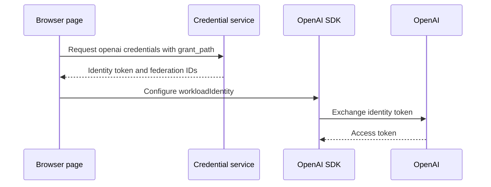

# @habemus-papadum/cf-creds-openai

Use OpenAI workload identity federation in a browser. The credential service
issues a short-lived identity token and returns the OpenAI identity-provider
and service-account IDs. The OpenAI SDK exchanges that token and requests a
replacement when its access token needs renewal.



The package's peer dependency is `openai`.

```ts
import { createBrokeredOpenAI } from "@habemus-papadum/cf-creds-openai";

const { client, manager } = await createBrokeredOpenAI({
  base: "https://creds.example.com",
  grantPath: "research",
});

manager.onRotate((credentials) => showExpiry(credentials.expiration));
const response = await client.responses.create({ model: "gpt-4o-mini", input: "hi" });
```

The factory makes the first credential request before returning the configured
client. Later requests occur on demand when the SDK asks for a token and the
cached token expires within 30 seconds. This manager uses no refresh timer.

`createOpenAICredentialManager()` returns the credential manager alone.
`brokeredSubjectTokenProvider()` adapts it to the OpenAI SDK's token callback.
The factory also enables the SDK's browser support and supplies a fetch wrapper
that preserves the browser's required function binding.

The service needs an OpenAI project, a service account with a project role,
and a workload identity provider registered for its issuer and audience. The
provider mapping associates the JWT `grant_path` claim with the service account.
Update existing mappings that use the previous `key` claim when deploying the
new service. Until those mappings are updated, token exchange will fail.

## Versions through 0.5

Versions through 0.5 used AWS STS `GetWebIdentityToken` and an AWS role per grant.
The current package uses service-issued identity tokens. The old
`createFederatedOpenAI()` and `awsSubjectTokenProvider()` entry points were removed
in 0.6. A service that still returns the old AWS envelope requires a 0.5 client.

## Inject a credential source

Use a custom authentication or discovery protocol through a source:

```ts
import { createOpenAIFromSource } from "@habemus-papadum/cf-creds-openai";

const client = await createOpenAIFromSource({
  get: () => applicationCredentials.get(),
});
```

The source returns `OpenAICredentials` and owns response validation, caching,
renewal and cleanup. The factory makes no broker request of its own, starts
no timer and does not substitute another credential source on failure.

The first bundle fixes the client's audience, identity-provider ID and
service-account ID. A later bundle with different coordinates is rejected
without exposing those values. Create a new client when deliberately changing
targets. `createBrokeredOpenAI()` uses the same coordinate check and keeps its
existing URL options and `{ client, manager }` result.

`brokeredSubjectTokenProvider()` also accepts a source. This lower-level adapter
returns its current identity token; callers constructing the SDK themselves
are responsible for keeping its federation coordinates consistent.
